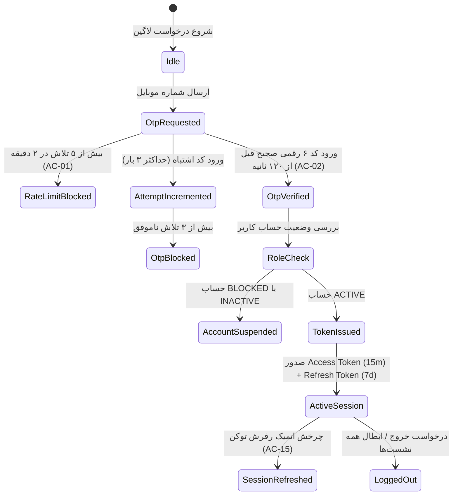
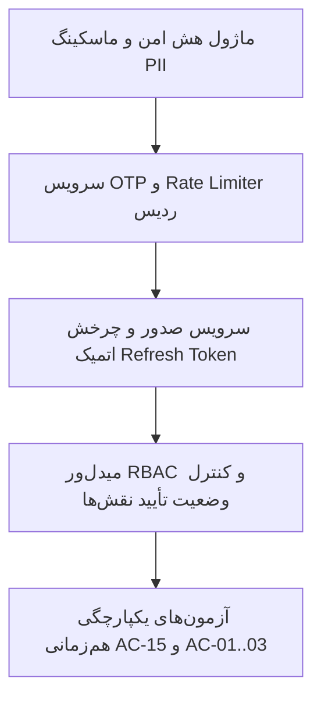

# سند طراحی معماری و قرارداد پیاده‌سازی فاز ۲: احراز هویت، RBAC و چرخه نشست (HC-T07)
**Document ID:** `DOC-HC-PHASE2-AUTH-RBAC-DESIGN`  
**Run ID:** `RUN-HAMICARD-001`  
**Task ID:** `HC-T07` (Command `HC-CMD-008`)  
**Scope:** DESIGN_ONLY (فاقد هرگونه تغییر دیتابیس عملیاتی یا سورس‌کد اجرایی)  
**Target:** Master Commander & Development Coordinators  
**Baseline:** PRD v1.0 (بخش‌های ۳، ۴، ۲۲؛ معیارهای AC-01، AC-02، AC-03، AC-13، AC-14، AC-15)

---

## ۱. مدل هویت و ماتریس دسترسی مبتنی بر نقش (RBAC_MATRIX)

### نقش‌های ۵ گانه سامانه:
1. `SUPER_ADMIN`: مدیر ارشد کل سامانه (غیرقابل تنزل/حذف خودکار).
2. `ADMIN`: مدیر عملیاتی با دسترسی‌های تفویض‌شده.
3. `DOCTOR`: پزشک یا مرکز درمانی طرف قرارداد (نیازمند تأیید هویت و نظام پزشکی).
4. `AGENT`: نماینده استانی یا شهری فروش و خدمات.
5. `MARKETER`: بازاریاب کددار.
6. `USER`: دارنده حامی‌کارت / بیمار عادی.

### ماتریس مجوزهای دسترسی (T07-AC1):

| ماژول / عملیات | SUPER_ADMIN | ADMIN | DOCTOR (تأییدشده) | AGENT (تأییدشده) | MARKETER | USER |
| :--- | :---: | :---: | :---: | :---: | :---: | :---: |
| مشاهده داشبورد سیستم و تنظیمات | ✅ | ✅ (محدود) | ❌ | ❌ | ❌ | ❌ |
| ویرایش تنظیمات پارامتریک (OPEN-01..18) | ✅ | ❌ | ❌ | ❌ | ❌ | ❌ |
| تأیید / رد پروفایل پزشک و نماینده | ✅ | ✅ | ❌ | ❌ | ❌ | ❌ |
| ثبت ویزیت و کسر سهمیه (AC-07) | ❌ | ❌ | ✅ | ❌ | ❌ | ❌ |
| صدور کارت / ثبت عضویت کاربر | ✅ | ✅ | ❌ | ✅ | ❌ | ❌ |
| ثبت درخواست تسویه مالی (AC-12) | ❌ | ❌ | ✅ | ✅ | ✅ | ❌ |
| تأیید و پرداخت تسویه مالی | ✅ | ✅ | ❌ | ❌ | ❌ | ❌ |
| مشاهده تاریخچه ویزیت‌های شخصی | ❌ | ❌ | ❌ | ❌ | ❌ | ✅ |

### سیاست تفکیک وظایف و وضعیت‌های در انتظار تأیید (T07-AC3):
- پزشک یا نماینده در وضعیت `PENDING` یا `REJECTED` **به هیچ وجه نمی‌تواند** امتیازات عملیاتی (مانند ثبت ویزیت یا درخواست تسویه) را اجرا کند.
- هر درخواست عملیاتی از پزشک یا نماینده علاوه بر احراز توکن JWT، وضعیت `verification_status == 'APPROVED'` را در دیتابیس استعلام و اعتبارسنجی می‌کند.

---

## ۲. ماشین وضعیت احراز هویت و ورود OTP / پسورد (AUTH_STATE_MACHINE)

### نیازمندی‌های کلیدی جریان OTP و رمز عبور:
1. **رمزنگاری و هش پسورد:** استفاده از الگوریتم `Argon2id` با پارامترهای استاندارد OWASP.
2. **انقضا و تلاش OTP (AC-01, AC-02):** انقضای ۱۲۰ ثانیه در Redis با کلید موقت، حداکثر ۳ تلاش ورود نادرست و مسدودسازی ۱۵ دقیقه‌ای در صورت تخطی.
3. **عدم نشت داده در لاگ‌ها (PII Privacy):** ممنوعیت مطلق ثبت مقادیر رمز عبور، متن OTP، شماره کارت بانکی، شماره شبا یا کد ملی به صورت متن خام در لاگ‌های سیستمی.

---

## ۳. چرخه حیات نشست و آزمون رقابت تمدید توکن (AC-15 / REFRESH_RACE_TEST_PLAN)

### پروتکل چرخش اتمیک رفرش توکن (Token Rotation with Replay Detection):
1. هر درخواست تجدید نشست با ارسال `refresh_token` جاری صورت می‌گیرد.
2. توکن‌های رفرش در جدول `refresh_tokens` با شناسه یکتا، هش SHA-256 توکن، شناسه خانواده نشست (`family_id`) و پرچم `is_revoked` نگهداری می‌شوند.
3. **تشخیص سوءاستفاده و Replay (AC-15):**
   - اگر یک `refresh_token` که قبلاً مصرف یا باطل شده مجدداً برای درخواست نشست جدید ارسال شود، سیستم بلافاصله **تمام توکن‌های عضو آن `family_id`** را باطل کرده و نشست کاربر را به عنوان «مشکوک به نفوذ» مسدود می‌کند.
4. **تضمین هم‌زمانی رقابتی (Competitive Refresh):**
   - در صورت ارسال هم‌زمان دو درخواست تجدید با یک توکن رفرش، تراکنش اول با قفل سطری PostgreSQL توکن را مصرف کرده و جانشین صادر می‌کند. درخواست دوم با خطای `TOKEN_ALREADY_USED` مواجه شده و در بازه زمانی Grace Period مجاز (مثلاً ۵ ثانیه) آخرین توکن معتبر صادرشده را دریافت می‌کند، بدون اینکه خانواده ابطال گردد.

---

## ۴. گراف وظایف پیاده‌سازی و مرزهای بازگشت (IMPLEMENTATION_TASK_GRAPH)

### مرزهای Rollback و امنیت:
- پیاده‌سازی فاز ۲ تا پیش از دریافت مجوز نهایی از فرمانده و بررسی ادغام گیت، روی شاخه مستقل `feature/auth-rbac-core` نگهداری خواهد شد.
- هیچ‌گونه دسترسی خارجی یا تغییرات در پایگاه داده پروداکشن ایجاد نمی‌شود.

