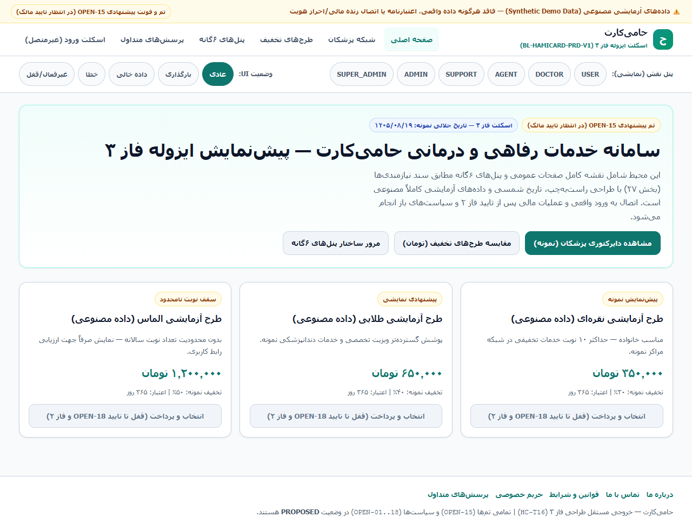
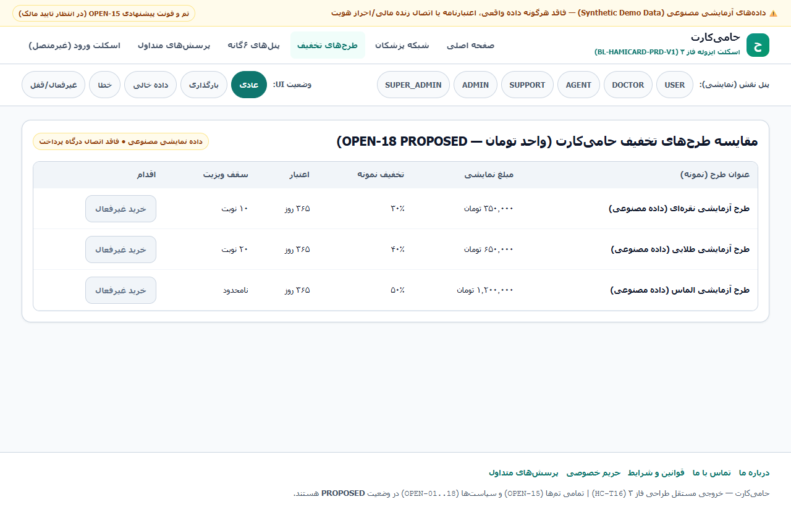
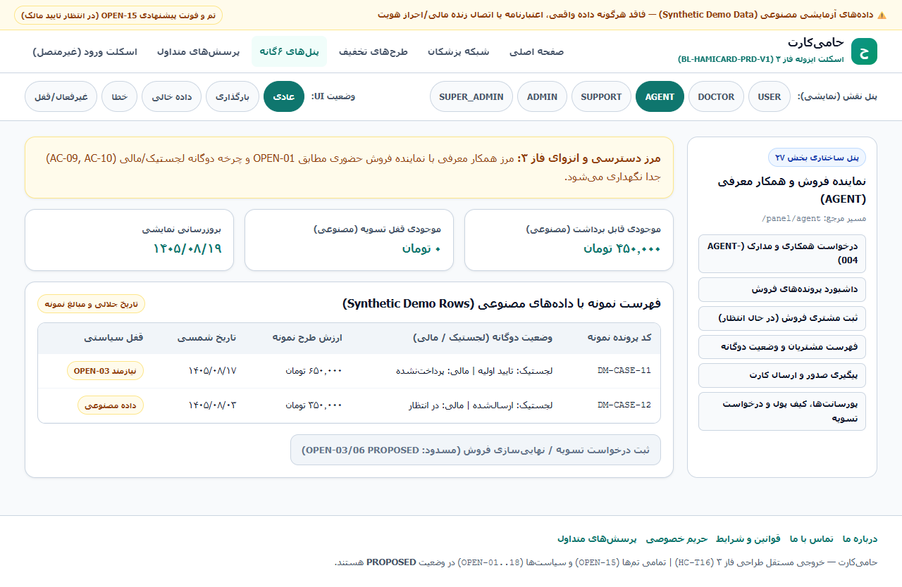
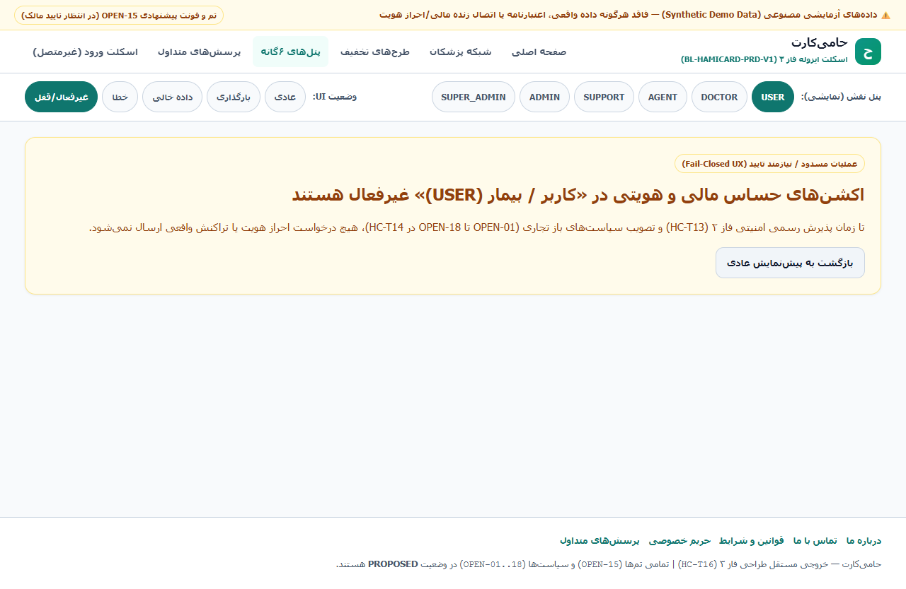
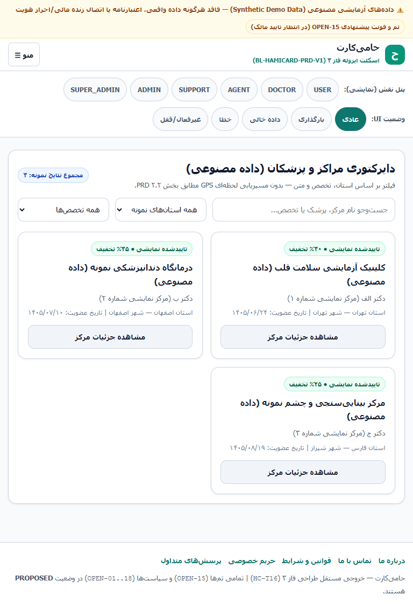
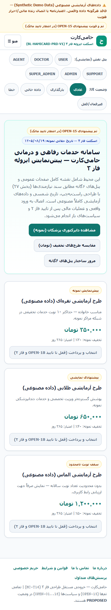
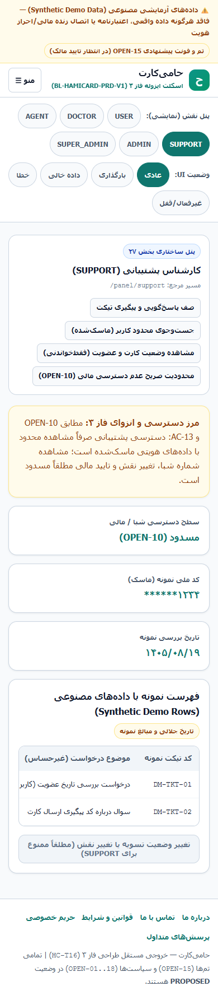

# بسته رسمی بررسی مالک محصول و پیش‌نمایش رابط کاربری فاز ۳ حامی‌کارت (`HC-T48`)

> **وضعیت حاکمیتی (Fail-Closed):** تمامی **۱۸ قانون تجاری (`OPEN-01` تا `OPEN-18`)** و انتخاب هویت بصری (**`OPEN-15`**) هم‌اکنون در وضعیت **`PROPOSED` (پیشنهادی و تاییدنشده)** قرار دارند. هیچ قاعده‌ای به صورت خودکار تایید نشده است و پیش‌نمایش UI **صرفاً از داده‌های نمایشی مصنوعی** استفاده می‌کند (بدون اتصال به درگاه پرداخت، پیامک یا `/api/v1/` واقعی).

---

## ۱. لینک‌های مستقیم و قابل دسترس برای مالک (بدون نیاز به IDE محلی)

- **راهنمای کامل و گالری تصویری فارسی (همین سند):** [OWNER_REVIEW_FA.md](https://github.com/mytest19861986/hami3/blob/docs/hc-t48-owner-preview/docs/owner_preview/OWNER_REVIEW_FA.md)
- **ماتریس کامل ۱۸ قانون تجاری (`OPEN-01..18`):** [OWNER_DECISION_MATRIX_FA.md](./OWNER_DECISION_MATRIX_FA.md) | [لینک مستقیم گیت‌هاب](https://github.com/mytest19861986/hami3/blob/docs/hc-t48-owner-preview/docs/owner_preview/OWNER_DECISION_MATRIX_FA.md)
- **گالری آفلاین تک‌فایل HTML (بازشدنی در هر مرورگر دسکتاپ/موبایل):** [index.html](./index.html) | [لینک مخزن گیت‌هاب](https://github.com/mytest19861986/hami3/blob/docs/hc-t48-owner-preview/docs/owner_preview/index.html)
- **مانیفست اصالت فایل‌ها و هش‌ها:** [OWNER_PACKAGE_MANIFEST.json](./OWNER_PACKAGE_MANIFEST.json)

### مشخصات مرجع کد و تصاویر (Source Provenance)
- **مبنای سورس طراحی و اسکرین‌شات‌ها (`OPEN-15` / شاخه ایزوله `fix/hc-t28-ui-a11y-polish`):**
  - `DESIGN_MANIFEST_SHA`: `e60499a872d1662f06816da4b33759c7ed7c960f`
  - `UI_SOURCE_SHA`: `af9534cf4d1f005eaa67233fdbda0f7f6fb7e38c` (`tree 6e90ce76db234067b3c4d9264a40dd08e1b3478b`)
- **مبنای شاخه `develop` (محل تعریف `OPEN-01..18` در `db/seed.sql`):**
  - `BASE_DEVELOP_SHA`: `309a5853a3e9ee5503b4866b9370a8398c97264f`
- **بسته انتشار مستندات (`HC-T48`):** شاخه `docs/hc-t48-owner-preview` (بدون دستکاری در کد اجرایی، بدون مرج در `main` و با حفظ کامل هر ۱۳ اسکریپت کمکی ردیابی‌نشده).

---

## ۲. بررسی بصری `OPEN-15` (رنگ‌ها، فونت و چیدمان) و ۷ اسکرین‌شات تاییدشده

### الف) انتخاب‌های بصری وابسته به تایید مالک (`OPEN-15 = PROPOSED`)
این تنظیمات کاملاً برگشت‌پذیر هستند و در فایل `src/ui_shell/styles/tokens.css` تعریف شده‌اند:
- **رنگ اصلی برند:** `#0d9488` (`Teal 600`) و رنگ تاکیدی `#0f766e` (`Teal 700`)
- **رنگ مکمل موفقیت / وضعیت فعال:** `#059669` (`Emerald 600`)
- **رنگ پس‌زمینه و کارت‌ها:** پس‌زمینه `#f8fafc`، کارت `#ffffff`، حاشیه `#cbd5e1`
- **فونت فارسی (`--hc-font-sans`):** `'Vazirmatn', 'IRANSansX', 'Tahoma', system-ui, -apple-system, sans-serif` (با فالبک بدون CDN خارجی)
- **لحن متون فارسی، گردی گوشه‌ها (`1rem`) و چینش صفحه اصلی**

### ب) الزامات فنی ثابت (مستقل از رنگ و سلیقه برند)
در تمام پالت‌های پیشنهادی یا انتخابی مالک، این استانداردها حفظ می‌شوند:
1. ابعاد لمسی ایمن `44×44px` برای پیل‌های شبیه‌ساز و دکمه بستن منو (`D-1`)
2. ناحیه اعلان زنده محدود `#hc-live-status` بدون بازخوانی کل صفحه (`D-2`)
3. مدیریت تله فوکوس منوی موبایل و جزئیات پزشک (`D-3`, `D-4`)
4. ناوبری کیبورد `role="radiogroup"` هماهنگ با جهت‌یابی `RTL` (`D-5`)
5. کنتراست حداقل `WCAG AA >= 4.5:1` و اسکرول افقی صفحه برابر صفر

---

## ۳. گالری ۷ اسکرین‌شات تاییدشده رابط کاربری (`e60499a8` / `af9534cf`)

### صفحه اصلی دسکتاپ (۱۲۸۰×۸۰۰)
- **مسیر / نقش / وضعیت:** `home / USER / NORMAL`
- **SHA256 تصویر:** `430e4f462545e3cb428b1e26a956712d8c4db77752c5a73b62e28164edc35945` (111,152 بایت)
- **نکات کلیدی:** چیدمان راست‌به‌چپ (RTL)، بنر شفاف PROPOSED، پیل‌های شبیه‌ساز ۴۴×۴۴ پیکسل و کنتراست استاندارد
- **لینک مستقیم تصویر در مخزن:** [مشاهده `desktop_home.png`](./screenshots/desktop_home.png) | [نسخه Raw در گیت‌هاب](https://raw.githubusercontent.com/mytest19861986/hami3/docs/hc-t48-owner-preview/docs/owner_preview/screenshots/desktop_home.png)

### صفحه طرح‌های تخفیف دسکتاپ (۱۲۸۰×۸۰۰)
- **مسیر / نقش / وضعیت:** `plans / USER / NORMAL`
- **SHA256 تصویر:** `85db410bde96618a99c382921e7ae24edec6db006bbea2d6481a6ff6926c4c31` (67,249 بایت)
- **نکات کلیدی:** کارت‌های نقره‌ای، طلایی و الماس به تومان با ارقام فارسی و ساختار واضح مزایا
- **لینک مستقیم تصویر در مخزن:** [مشاهده `desktop_plans.png`](./screenshots/desktop_plans.png) | [نسخه Raw در گیت‌هاب](https://raw.githubusercontent.com/mytest19861986/hami3/docs/hc-t48-owner-preview/docs/owner_preview/screenshots/desktop_plans.png)

### پنل نماینده دسکتاپ (۱۲۸۰×۸۰۰)
- **مسیر / نقش / وضعیت:** `panel / AGENT / NORMAL`
- **SHA256 تصویر:** `d0fa5cd7e0bfbc06af142460fb8f31ba7c7539328a9e1388271f74e11140c0b0` (94,029 بایت)
- **نکات کلیدی:** نوار ناوبری پنل، جدول با ظرف اسکرول افقی ایزوله و خلاصه فروش نمایشی مصنوعی
- **لینک مستقیم تصویر در مخزن:** [مشاهده `desktop_panel_agent.png`](./screenshots/desktop_panel_agent.png) | [نسخه Raw در گیت‌هاب](https://raw.githubusercontent.com/mytest19861986/hami3/docs/hc-t48-owner-preview/docs/owner_preview/screenshots/desktop_panel_agent.png)

### وضعیت قفل سیاستی دسکتاپ (۱۲۸۰×۸۰۰)
- **مسیر / نقش / وضعیت:** `panel / USER / DISABLED`
- **SHA256 تصویر:** `15892bd27f97904bf928336dd5adeca721d3ff2960f6965e0d75f4df50e2513e` (59,443 بایت)
- **نکات کلیدی:** نمایش شفاف وضعیت غیرفعال تا زمان تصویب رسمی OPEN-01..18 توسط مالک
- **لینک مستقیم تصویر در مخزن:** [مشاهده `desktop_state_disabled.png`](./screenshots/desktop_state_disabled.png) | [نسخه Raw در گیت‌هاب](https://raw.githubusercontent.com/mytest19861986/hami3/docs/hc-t48-owner-preview/docs/owner_preview/screenshots/desktop_state_disabled.png)

### شبکه پزشکان تبلت (۷۶۸×۱۰۲۴)
- **مسیر / نقش / وضعیت:** `doctors / USER / NORMAL`
- **SHA256 تصویر:** `704817f66aa5df2e80ec525bb7e5912ff5dc16affb4d5e2cc701d8842e61df46` (78,103 بایت)
- **نکات کلیدی:** گرید دو ستونه، جست‌وجو/فیلتر، دکمه‌های «مشاهده جزئیات مرکز» با بازگشت فوکوس دسترس‌پذیر
- **لینک مستقیم تصویر در مخزن:** [مشاهده `tablet_doctors.png`](./screenshots/tablet_doctors.png) | [نسخه Raw در گیت‌هاب](https://raw.githubusercontent.com/mytest19861986/hami3/docs/hc-t48-owner-preview/docs/owner_preview/screenshots/tablet_doctors.png)

### صفحه اصلی موبایل (۳۹۰×۸۴۴)
- **مسیر / نقش / وضعیت:** `home / USER / NORMAL`
- **SHA256 تصویر:** `ba21a5966c20ecca3cb2320d5b15165f471b4e2f3dda9ac27ab6ca5434dfa13b` (115,157 بایت)
- **نکات کلیدی:** منوی کشویی همبرگری با تله فوکوس، اهداف لمسی ۴۴×۴۴px و صفر اسکرول افقی صفحه
- **لینک مستقیم تصویر در مخزن:** [مشاهده `mobile_home.png`](./screenshots/mobile_home.png) | [نسخه Raw در گیت‌هاب](https://raw.githubusercontent.com/mytest19861986/hami3/docs/hc-t48-owner-preview/docs/owner_preview/screenshots/mobile_home.png)

### پنل پشتیبان موبایل (۳۹۰×۸۴۴)
- **مسیر / نقش / وضعیت:** `panel / SUPPORT / NORMAL`
- **SHA256 تصویر:** `1dcca1cac9a043babd521e604f91a8fae12eb03980710ff968a1edf3fd58f600` (83,337 بایت)
- **نکات کلیدی:** عدم نمایش شبا کامل و عملیات مالی در نمای پشتیبانی منطبق با OPEN-10 و SETTLE-015
- **لینک مستقیم تصویر در مخزن:** [مشاهده `mobile_panel_support.png`](./screenshots/mobile_panel_support.png) | [نسخه Raw در گیت‌هاب](https://raw.githubusercontent.com/mytest19861986/hami3/docs/hc-t48-owner-preview/docs/owner_preview/screenshots/mobile_panel_support.png)

---

## ۴. خلاصه تصمیم‌های تجاری `OPEN-01` تا `OPEN-18` (متن و جدول کامل در `OWNER_DECISION_MATRIX_FA.md`)

> تمامی ۱۸ ردیف زیر هم‌اکنون در `db/seed.sql` با وضعیت `PROPOSED` ذخیره شده‌اند.

| شناسه | موضوع تصمیم | مقدار پیشنهادی پیش‌فرض (`PROPOSED`) | گزینه‌های اصلی جایگزین | اثر تجاری / ریسک |
|---|---|---|---|---|
| **OPEN-01** | مرز معرف و نماینده فروش | `allow_referrer_sales_cases: false`, `referrer_requires_agent_approval: true` | ادغام معرف/نماینده بدون تایید؛ یا تعلیق معرف | جلوگیری از ثبت مشتری صوری و نشت پورسانت |
| **OPEN-02** | اولویت درصد تخفیف پزشک و طرح | `precedence: "CUSTOM_FIRST"` | `PLAN_FIRST` یا `MIN` / `MAX` | پشتیبانی از قراردادهای اختصاصی مطب‌ها |
| **OPEN-03** | زمان فعال‌سازی عضویت فروش نماینده | `PAYMENT_RECORDED_AND_CASE_APPROVED`, `auto_activate_membership: true` | فعال‌سازی پس از صدور/تحویل فیزیکی (`false`) | کارت دیجیتال فوری در برابر شروع اشتراک از لحظه تحویل |
| **OPEN-04** | تفکیک مجوزهای مالی و تسویه | ثبت پرداخت: `ADMIN/SUPER_ADMIN`؛ تسویه و تنظیمات: فقط `SUPER_ADMIN` | محدودسازی کل امور به `SUPER_ADMIN` | کاهش ریسک تقلب داخلی در تسویه بانکی |
| **OPEN-05** | هم‌زمانی پورسانت فروش و معرفی | `allow_combined: false`, `max_total_percent: 30.0` | `allow_combined: true` با سقف `<= 25%` | جلوگیری از حاشیه سود منفی و تبانی |
| **OPEN-06** | حداقل تسویه و مسدودی آنی موجودی | `min_amount_toman: 100000`, `lock_on_request: true` | تغییر سقف به ۵۰ تا ۵۰۰ هزار تومان | قفل آنی مانع برداشت مضاعف هم‌زمان می‌شود |
| **OPEN-07** | لغو ویزیت، مرجوعی و سهمیه | `restore_quota: true`, `refund_requires_reason: true` | محدودیت زمانی ۲۴ ساعت / تایید مدیر | جلوگیری از آربیتراژ مالی و حذف دلیل ممیزی |
| **OPEN-08** | چند طرح فعال برای یک کدملی | `allow_multiple_active_plans: false`, `extension_adds_to_end_date: true` | اجازه چند طرح هم‌زمان با قاعده اولویت | سادگی محاسبه سهمیه و درصد تخفیف در مطب |
| **OPEN-09** | یکتایی کدملی و تغییر موبایل | `national_code_unique: true`, `phone_change_requires_admin: true` | OTP دوطرفه بدون مدیر | جلوگیری از تصاحب کارت و نشت سوابق |
| **OPEN-10** | اختیارات پشتیبان و مدیر | `support_can_view_sheba: false`, `support_can_approve_financials: false` | نمایش ۴ رقم آخر (ماسک‌شده فعلی) | تطابق با حداقل دسترسی (`SETTLE-015` / `AC-13`) |
| **OPEN-11** | سرویس پیامک و درگاه پرداخت زنده | `sms_provider: "mock"`, `payment_gateway: "mock"`, `is_production_ready: false` | اتصال کاوه‌نگار/زرین‌پال پس از قرارداد | در محیط عملیاتی تا اتصال واقعی مسدود (`503`) است |
| **OPEN-12** | نگهداری اسناد مالی و حذف کاربر | `soft_delete_only: true`, `retain_financial_records_days: -1` | بازه قانونی مشخص + ناشناس‌سازی PII غیردفترکل | حفظ تراز دفترکل و قابلیت ممیزی مالی |
| **OPEN-13** | نگهداری و رمزنگاری بکاپ | `daily: 7, weekly: 4, monthly: 6`, `encrypt_with_age: true` | افزودن WAL ساعتی / نگهداری ۱۲ ماهه | پیشگیری از نشت گسترده PII در نسخه پشتیبان |
| **OPEN-14** | کارایی، ظرفیت و سقف OTP | `max_concurrent_users: 500`, `api_p95_ms: 200`, `otp_rate_limit_per_hour: 5` | افزایش سقف هم‌زمانی یا محدودیت ۳-۵ OTP | کنترل هزینه پیامک و جلوگیری از SMS-bombing |
| **OPEN-15** | هویت بصری، رنگ و فونت نهایی | `font_family: "Vazirmatn"`, `#0d9488`, `#059669` | تغییر رنگ/فونت با حفظ کنتراست ۴.۵:۱ | تثبیت هویت برند پیش از انتشار نهایی |
| **OPEN-16** | حد اطلاعات پزشکی در ویزیت | `store_diagnosis: false`, `store_full_emr: false`, `allow_private_notes: true` | افزودن نسخه/تشخیص ساختاریافته | پرهیز از تعهدات حقوقی سنگین پرونده EMR |
| **OPEN-17** | اعطای طرح رایگان توسط مدیر | `roles_allowed: ["ADMIN","SUPER_ADMIN"]`, `mandatory_reason: true` | محدودسازی فقط به `SUPER_ADMIN` | جلوگیری از اعطای بدون دلیل و پورسانت صوری |
| **OPEN-18** | واحد پول و گرد کردن | `currency_stored: "TOMAN"`, `currency_display: "TOMAN"`, `rounding_mode: "FLOOR"` | تغییر به `HALF_UP`/`CEIL` (ریال توصیه نمی‌شود) | جلوگیری از خطای ۱۰ برابری و مغایرت دفترکل |

---

## ۵. اقدام درخواستی از مالک محصول

1. فایل کامل [`OWNER_DECISION_MATRIX_FA.md`](./OWNER_DECISION_MATRIX_FA.md) را بررسی و وضعیت هر یک از **۱۸ بند `OPEN-01` تا `OPEN-18`** را مشخص فرمایید (`تایید پیش‌فرض` / `اصلاح با مقدار جدید` / `تعلیق`).
2. درباره **رنگ، فونت و چیدمان (`OPEN-15`)** بر اساس ۷ تصویر بالا یا گالری [`index.html`](./index.html) نظر خود را اعلام فرمایید.
3. تا دریافت پاسخ صریح شما، تمام موارد در وضعیت `PROPOSED` باقی می‌مانند و هیچ ادغام خودکار یا تنظیم تولیدی تغییر نمی‌کند.
